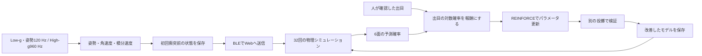

# 初回衝突の出目予測と学習



外寸の初期値は実測の15 mmです。角丸半径0.8 mm、反発係数0.4、摩擦係数0.3は仮の初期値です。まだ実機の投擲記録がなく、的中率や学習による改善は未検証です。

## 実機での使い方

1. Webアプリでサイコロを接続します。
2. 「面校正」で、各面を上にして静止させ、その番号を登録します。6面すべて必要です。v1の校正データは引き継ぎません。
3. 「学習」で投げる面に名前を付け、外寸・角丸を設定します。同じ面・外寸の記録とモデルをまとめます。素材が変わったら面の名前を変えてください。
4. 「予測 ON」にして投げます。最初の衝突の情報だけで計算し、その投擲中は更新しません。
5. 静止後に、実際に出た目の番号を押します。静止姿勢からの推定をそのまま正解にはしません。
6. 学習16投、検証5投、テスト5投が集まると「強化学習する」が使えます。分割が偏るため、開始目安は40〜60投です。6種類の目と多様な回転・落下を含む100投以上を集めると評価しやすくなります。

自動学習は必要数に達した後、正解確認が10投増えるごとに実行します。「学習を停止」で直ちに中断できます。学習と予測は別々のWeb Workerで動くため、学習中もBLEの受信・姿勢表示が続きます。採用したパラメータは次の投擲から使います。

実機・6面校正済み・人が正解確認済み・衝突までのジャイロ飽和なしの記録を学習対象にします。現在のジャイロ設定±4000 dps（旧ファームは±2000 dps）で飽和した投擲は入力が欠けるため、不確かな予測として表示し、学習から外します。加速度の飽和回数は記録に残します。

記録とモデルはこのブラウザに保存します。「記録DL」「モデルDL」でバックアップでき、「記録・モデルを読む」で取り込めます。取り込みはv2形式の実機記録だけを受け付け、同じ投擲IDは追加しません。合成テストデータは実機記録や実機学習モデルとして取り込めません。外部サーバーへは送信しません。

## 予測の入力と物理モデル

ファームウェアはFREEFALLから最初の衝突を検出すると、衝撃を受ける15 ms以上前のサンプルを送信します。サンプルの実際の時刻を使い、姿勢・角速度・積分速度を衝突まで外挿します。従来の50バイト衝突パケットも読めますが、その場合の時間差は25 msと仮定します。

Rapier 0.14の角丸立方体を床に接触させ、32通りのばらつきで着地まで計算します。6面校正は出目の判定だけでなく、IMUに対する立方体の向きにも使います。15 mm形状に合わせて接触許容値を指定し、重心・慣性を明示します。収束しない試行は6面に確率を分配し、確率の平滑化で0%や100%の断定を避けます。

予測は初回衝突のq/ω/vと校正・モデルだけを使います。静止時の姿勢や衝突後のストリームは推論に入力しません。RESULT通知までに計算が終わらなかった場合、その予測は表示・的中集計から外します。RESULTは300 msの静止判定後の通知なので、この判定だけで「物理的な静止前に表示できた」とは保証しません。計算時間も記録します。

## 強化学習

[WilliamsのREINFORCE](https://doi.org/10.1007/BF00992696)を使った、1ステップのパラメータ選択です。ガウス方策が物理パラメータを選び、実測の出目に割り当てた確率の対数を報酬にします。投げ方を制御する方策ではありません。

学習対象は反発、摩擦、角減衰、積分速度の倍率、角速度の倍率、重心XYZ、慣性倍率、衝突時刻の補正の10項目です。物理範囲を制約し、初期値から離れすぎる候補に小さなペナルティを課します。対称なパラメータ摂動と共通の乱数シードでシミュレーションのばらつきを減らします。

投擲IDの固定ハッシュで学習70%・検証15%・テスト15%に分けます。再学習しても同じ投擲は同じ区分に留まります。学習データで方策を更新し、検証データで負の対数尤度が0.005以上改善し、的中率が下がらない候補だけを採用します。最後に、候補を固定してからテストデータを開きます。テストは更新・採用判断には使いません。

画面とモデルJSONには、検証・テストの的中率と件数を残します。JSONには負の対数尤度とBrier scoreも残します。検証で改善しても、テストの的中率が下がる場合があります。繰り返し表示する固定テストは毎回新しい独立試験ではないため、最終評価には別途新しい投擲を使ってください。少数投擲の的中率をそのまま性能保証とは扱いません。

## PCでの再学習

Webと同じTypeScriptの物理・学習コアをNodeで実行します。別実装の学習器はありません。

```sh
cd v2/software
npm run train -- --input /absolute/path/dice-throws-v2-….json \
  --output /absolute/path/dice-model-v2.json --profile '木の試験面' --iterations 12
```

既存のモデルから続ける場合は`--initial /absolute/path/dice-model-v2.json`を指定します。面名が外寸違いで複数存在する場合は、JSONの`profile`文字列をそのまま指定してください。出力したモデルはWebの読み込みボタンから適用できます。改善しなければ元のモデルを保持し、`lastTrainingReport`に今回の評価を残します。

## 検証

`npm test`は符号、面校正、実機記録の選別、BLEの新旧形式、固定分割、REINFORCEの報酬改善、テストへの漏洩防止、改善なしのモデル保持、実物理エンジンでのリプレイを確認します。報酬改善のテストは既知の合成関数で学習実装を検証するもので、実機の的中率ではありません。

ファームウェアのホストテストは、120 Hzを含む複数周期で初回衝突だけが通知され、衝突前時刻と着地の投擲番号が正しいことを確認します。実機への新しいファームウェアの書き込み後には、実際の投擲記録で検出閾値と計算完了時刻も確認してください。
